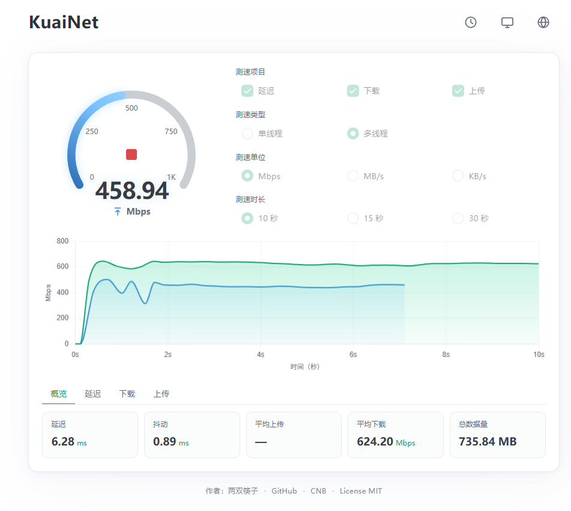
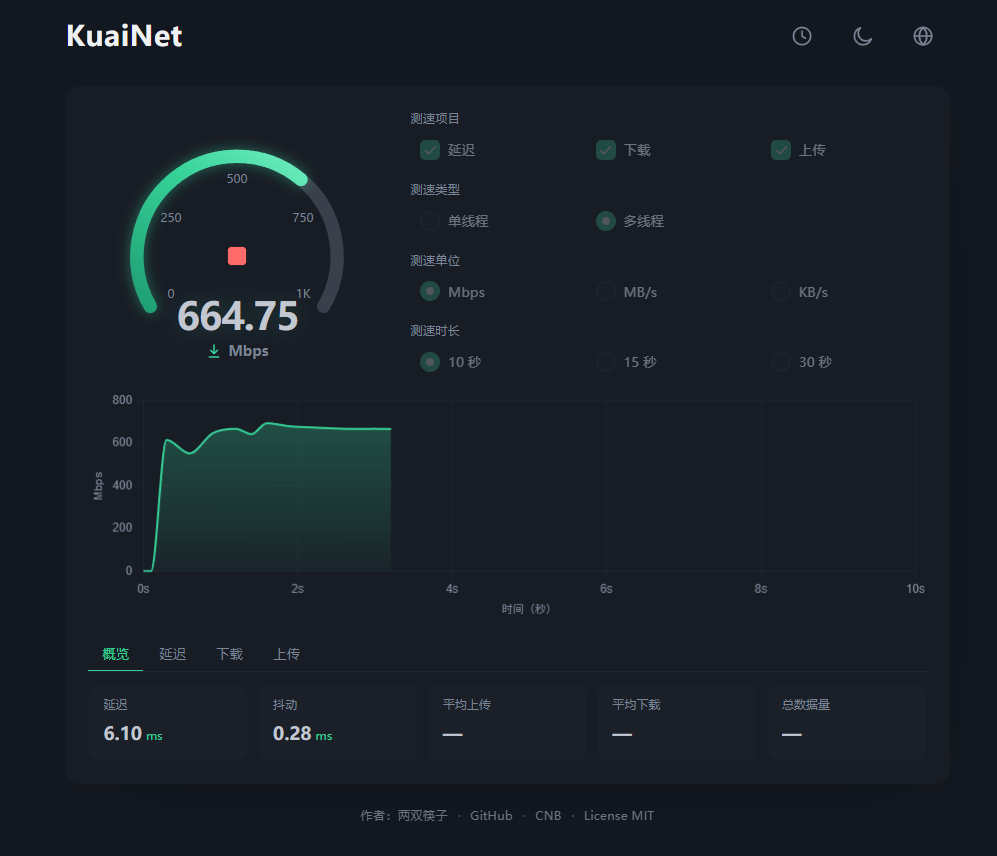
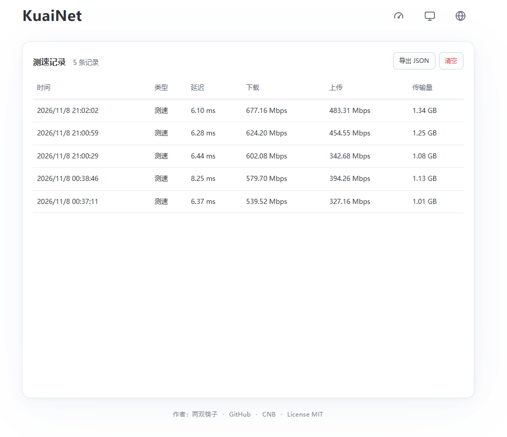
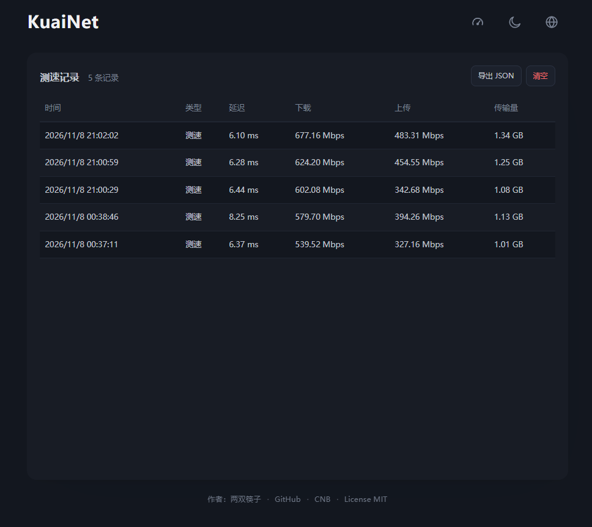
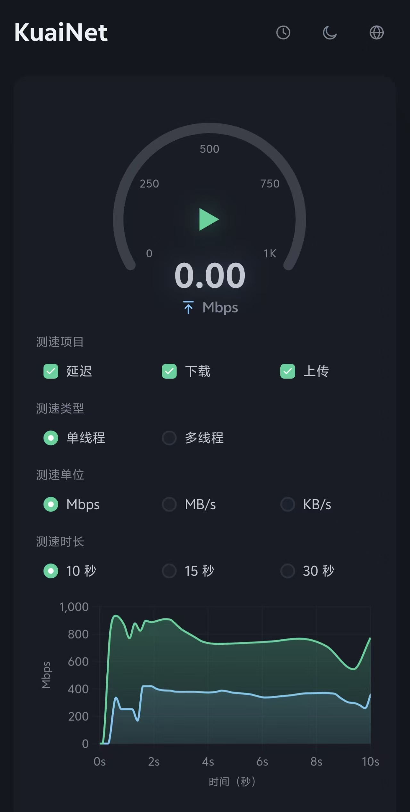
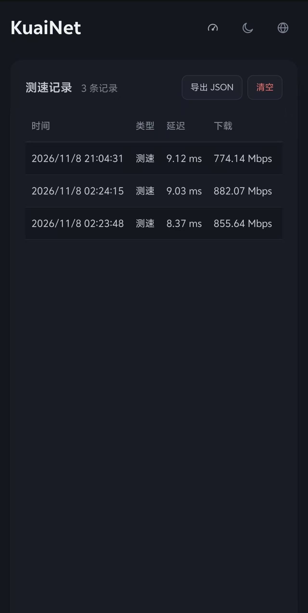

# KuaiNet

基于 Go 语言的极简内网服务器测速工具，测量服务器与浏览器或终端客户端之间的下载、上传速度和延迟。

编译后是单个可执行文件，前端资源全部内嵌，**不依赖 CDN、不需要 Node.js**，内网和离线环境开箱即用。

<p align="center">
  
  
</p>

<p align="center">
  <sub>测速界面：SVG 仪表盘 + 实时曲线 + 结果概览 · 左：浅色 / 右：深色</sub>
</p>

---

## 功能

### 测速

- **延迟**：连续 10 次探测，输出最小 / 平均 / 最大延迟与抖动
- **下载**：多路并发流式下载，实时生成不可压缩数据
- **上传**：多路并发分块上传，服务端读取后直接丢弃，**不写磁盘**
- **单线程 / 多线程**：一键切换并发路数
- **时长可选**：10 秒 / 15 秒 / 30 秒，**严格跑满**，不会提前中断
- **测试项目可勾选**：只测延迟、只测下载、只测上传，或全部一起测
- 测试过程中可随时停止，已完成的部分会保留

### 精准计时（核心）

测量结果**不用「总流量 ÷ 总时间」**——那样会把 TCP 慢启动阶段一起算进去，高速网络下结果明显偏低。

实际做法是「掐头去尾」：

| 阶段 | 时间 | 是否计入结果 |
|---|---|---|
| 预热（慢启动） | 前 1.5 秒 | ❌ 流量照常计入总传输量，但不参与速度计算 |
| **稳态区间** | 1.5 秒 ~ 结束前 0.5 秒 | ✅ **只取这一段**：区间字节差 ÷ 区间时间差 |
| 收尾（断连前掉速） | 最后 0.5 秒 | ❌ 剔除 |

- 收尾窗口按时长自适应：取 `时长 × 15%` 与 `0.5 秒` 的较大值，但不超过时长的一半
- 稳态区内再剔除前后各 5% 的离群点，避免偶发卡顿影响均值
- 峰值额外做「5 点中位数滤波 + 1 秒滑窗」，防止一次补发积压数据把峰值虚高几十倍

效果（真实 1000 Mbps 链路，前 1.5 秒线性爬坡）：

| 计算方式 | 结果 |
|---|---|
| 总流量 ÷ 总时间 | 929.6 Mbps |
| **掐头去尾** | **999.3 Mbps** |

### 平滑曲线

实时曲线是两级平滑的结果，不是原始瞬时速度的硬折线：

```
原始瞬时速度 → 滑动平均（最近 1.5 秒）→ 指数移动平均（EMA, α=0.35）→ 曲线
```

- **滑动平均**：按时间戳淘汰旧点，消除单点毛刺
- **EMA**：对滑窗均值再做时间加权，抹掉「窗口滑动导致的阶梯跳变」

相邻采样点的平均跳变从 27.7 Mbps 降到 2.9 Mbps（**降低约 90%**），曲线连续过渡、不顿挫。

> 采样频率 100ms（10Hz），曲线按 200ms 打点。所有速度都按「两点字节差 ÷ 两点真实时间差」计算，不假设采样间隔恒定，因此主线程繁忙或定时器被延迟时不会算出错误的速度。

### 仪表盘与实时曲线

- SVG 仪表盘，中心为开始 / 停止按钮，读数嵌在弧内
- 量程随速度自动升档，进度弧颜色区分测试项目（延迟＝黄、下载＝绿、上传＝蓝）
- 实时曲线同时展示下载（绿）与上传（蓝），曲线本身就是进度指示
- 实时显示当前速度、平均速度、峰值、传输量、耗时

### 结果与历史

- 结果分页查看：概览 / 延迟 / 下载 / 上传
- 每次测速保存为一条历史记录，本地最多保留 60 条
- 支持导出 JSON、一键清空
- **服务端不保存任何测速记录**，数据只在你自己的浏览器里

### 界面

- **10 种语言**：简体中文、繁體中文、English、日本語、한국어、Deutsch、Français、Español、Português (Brasil)、Русский
- **单位可切换**：Mbps / MB/s / KB/s
- **三种主题**：跟随系统 / 浅色 / 深色，切换时不闪白
- **配置自动记忆**：测试项目、线程、单位、时长、当前视图都会保存在浏览器里，刷新后不会回到默认值
- **自适应布局**：手机、平板、电脑都能正常使用
- **版本标识**：网页版在底部链接区后显示版本，终端客户端在标题后显示本机程序版本

---

## 使用

下载对应平台的发布包并解压，运行其中的可执行文件即可（以下示例将文件重命名为 `kuai-net`）：

```bash
./kuai-net
```

启动后终端会输出监听地址，浏览器打开 `http://服务器IP:8080`。

| 平台 | 发布包 | 压缩 |
|---|---|---|
| Linux x64 | `kuai-net-linux-amd64.tar.gz` | UPX |
| Linux ARM64 | `kuai-net-linux-arm64.tar.gz` | UPX |
| Windows x64 | `kuai-net-windows-amd64.tar.gz` | UPX |
| macOS Intel | `kuai-net-darwin-amd64.tar.gz` | 不使用 UPX |
| macOS Apple 芯片 | `kuai-net-darwin-arm64.tar.gz` | 不使用 UPX |

Windows 可直接双击 `.exe` 启动服务端；使用 TUI 时在 PowerShell / Windows Terminal 中运行 `./kuai-net-windows-amd64.exe c`。macOS 根据芯片选择对应文件，执行 `chmod +x` 后运行；首次运行可能需在「系统设置 → 隐私与安全性」中允许。

### Linux

```bash
# uname -m：x86_64 选 linux-amd64；aarch64 选 linux-arm64
chmod +x kuai-net-linux-amd64
./kuai-net-linux-amd64 -addr :8080
```

静态链接、无依赖，Alpine / Debian / Ubuntu / CentOS 均可直接运行。
systemd 常驻、Nginx 反代、防火墙与线上测速注意事项见 [docs/deploy-linux.md](docs/deploy-linux.md)。

可选参数：

| 参数 | 默认值 | 说明 |
|---|---|---|
| `-addr` | `:8080` | 监听地址与端口 |
| `-max-duration` | `30` | 单次测速的最长秒数（与前端时长选项一致） |

```bash
# 示例：监听 9000 端口
./kuai-net -addr :9000

# 想限制最长测试时长（例如只允许 10 秒档）
./kuai-net -addr :9000 -max-duration 10
```

### 终端客户端（TUI）

同一个可执行文件支持服务端和客户端两种模式。无子命令时启动服务端；`client` 和 `c` 都会打开终端测速界面，适合 SSH、Alpine 和两台服务器之间测速。

```bash
# 机器 A：启动 HTTP 测速服务
./kuainet -addr :8080

# 机器 B：进入 TUI，两条命令等效
./kuainet client
./kuainet c
```

`kuainet` 是示例文件名；下载的文件名为 `kuai-net-linux-amd64` 时，运行 `./kuai-net-linux-amd64 c`。

进入后首先通过纵向列表选择语言，提供与 Web 一致的 10 种语言，并高亮上次的选择。主界面使用统一配色，以标签对齐、带边框的紧凑表单显示当前配置。选项字段带 `▾` 标记：点击字段、按 Enter 或 Alt+↓，即可在字段下方展开选项列表；终端底部空间不足时自动调整展开位置。

在“服务端”弹窗中填写 IP 和端口，默认端口为 `8080`；也支持域名、`IP:端口`、IPv6 和 HTTP(S) URL。地址中明确指定的端口优先；完整的 HTTPS URL 未指定端口时使用 HTTPS 默认端口 `443`。反向代理部署在子路径下时可以填写完整地址，例如 `https://speed.example.com/net`。

测试项目下拉列表可多选延迟、下载、上传，点击或空格勾选后按 Enter 或点击确认按钮保存。并发数、时长、单位和语言使用单选下拉列表；鼠标点选直接保存，也可通过滚轮/上下键移动后按 Enter 确认。Esc 或点击列表外部取消修改并保留原值。支持鼠标事件的 SSH 终端可直接点击操作；不支持鼠标时仍可使用全部键盘操作。

测速时通过 ntcharts Canvas 展示半圆仪表盘，并通过 ntcharts 折线图展示下载与上传曲线；同时显示阶段进度、流量和最终平均/峰值。表单和图表均限制最大宽度，避免宽屏下左右内容相隔过远。小终端会简化布局，建议至少 80×24，完整上下图表布局建议 80×30 以上。

| 按键 | 操作 |
|---|---|
| `↑↓←→`、`j` / `k`、`Tab` / `Shift+Tab` | 按布局移动到配置项；下拉列表中用上下键选择 |
| 点击字段 / `Enter` / `Alt+↓` | 展开下拉列表；服务端字段打开地址输入弹窗 |
| 点击选项 / `Enter`（列表中） | 确认单选；历史表格中查看详情 |
| 滚轮（列表中） | 移动当前高亮项，不立即保存 |
| 点击 / `空格`（测试项目列表中） | 勾选/取消测试项，再 Enter 或点击确认保存 |
| `Esc` / 点击列表外部 | 取消当前修改并收起列表 |
| `h` / `l`（主界面） | 打开历史表格 / 语言列表 |
| `c`（历史表格） | 清空历史，弹窗确认后生效 |
| `Ctrl+R` | 开始或重新测速 |
| `Esc` / `s` / `Enter`（测试中） | 停止并保留已采集结果 |
| `Esc`（子页面） / `q` | 返回；主界面退出 |
| `Ctrl+C` | 退出客户端 |

下载和上传方向以**客户端所在机器**为准：下载为 A → B，上传为 B → A。延迟为 HTTP 往返耗时。客户端请求现有 `/api/ping`、`/api/download`、`/api/upload` 接口；上传以服务端返回的字节确认统计流量，内存中只复用固定大小的数据块。平均速度采用与 Web 一致的预热/收尾窗口，峰值采用中位数与滑窗滤波；过早停止导致采样不足时会明确显示“采样不足”。

客户端需要交互式终端。配置与最近 60 条历史记录保存在客户端本机的 `$XDG_CONFIG_HOME/kuainet/client.json`，未设置 XDG_CONFIG_HOME 时为 `~/.config/kuainet/client.json`。历史表格支持滚动、选中后查看详情及曲线，详情包括测速时的目标、配置、传输量、峰值、取样区间和停止/失败状态；修改当前配置不会更改历史结果。文件以临时文件写入再原子替换，损坏的数据不会被自动覆盖。

### 从源码构建

需要 Go 1.26 及以上。前端资源通过 `go:embed` 嵌入，构建产物是单个可执行文件。

```bash
go build -o kuai-net .
go test ./...

# 构建 Linux / Windows / macOS 五个目标，要求已安装 UPX
sh .cnb/scripts/release-build.sh
sh .cnb/scripts/verify-artifacts.sh
```

发布产物在 `release/`，包括上表的五个平台归档、对应可执行文件和 `SHA256SUMS.txt`。Linux 和 Windows 必须通过 UPX 压缩与完整性检查；macOS 为避免 Mach-O 兼容性问题不使用 UPX。所有目标禁用 CGO，Linux 为静态链接。CNB 在推送 tag 时自动测试、构建并发布到 CNB 和 GitHub；校验失败会中断发布。

发布脚本从 `VERSION`、CI 的 `CNB_BRANCH`（发布 tag）、`git describe --tags --always --dirty` 依次确定版本号，并注入同一可执行文件，供 Web 和 TUI 共用。本地未提交的构建带 `-dirty` 后缀；直接 `go build` 默认显示 `dev`。可以手动指定：

```bash
VERSION=v1.1.0 sh .cnb/scripts/release-build.sh
# 或直接构建时注入版本
go build -ldflags="-X main.version=v1.1.0" -o kuai-net .
```

---

## 浏览器兼容性

推荐使用 2023 年以后发布的浏览器，桌面端与移动端均可。

| 浏览器 | 最低版本 | 说明 |
|---|---|---|
| Chrome / Edge | 111+ | 推荐 |
| Firefox | 113+ | 推荐 |
| Safari（macOS / iOS） | 16.4+ | iOS 16.4 起支持所需特性 |
| Android 浏览器 / 微信内置浏览器 | Chromium 111+ | 部分旧机型可能偏低 |

测速依赖流式下载（`ReadableStream`）、`AbortController`、`color-mix()` 等现代特性，
过旧的浏览器（如 IE、旧版国产双核浏览器的兼容模式）无法运行。

若某台设备测不上速度，可先尝试更换浏览器内核（如极速模式）或升级系统。

---

## 注意事项

- **测速很费流量**：10 秒多并发在千兆内网可能产生数 GB 流量，注意服务器带宽或流量计费
- 上传测试的流量不写入磁盘，但会计入网卡流量
- 结果中的「平均速度」是稳态区间的值，可能高于「传输量 ÷ 耗时」，这是设计使然（慢启动段被剔除了）
- 建议仅在可信内网使用；如需公网暴露，请自行在反向代理层加上鉴权与限流

---

## 界面截图

> 截图放在 `docs/images/` 目录，同名覆盖即可更新。

**测速界面**

<table>
  <tr>
    <td width="50%" align="center" valign="top">
      <br>
      <sub><b>浅色主题</b></sub>
    </td>
    <td width="50%" align="center" valign="top">
      <br>
      <sub><b>深色主题</b></sub>
    </td>
  </tr>
</table>

**历史记录**

<table>
  <tr>
    <td width="50%" align="center" valign="top">
      <br>
      <sub><b>浅色主题</b>：本地保存最近 60 条，支持导出 JSON</sub>
    </td>
    <td width="50%" align="center" valign="top">
      <br>
      <sub><b>深色主题</b>：卡片高度与测速页一致，记录多时表格内部滚动</sub>
    </td>
  </tr>
</table>

**手机端**

<table>
  <tr>
    <td width="50%" align="center" valign="top">
      <br>
      <sub><b>测速界面</b>：单列布局，仪表盘与曲线纵向排列</sub>
    </td>
    <td width="50%" align="center" valign="top">
      <br>
      <sub><b>历史记录</b>：列表可横向滑动查看全部列</sub>
    </td>
  </tr>
</table>

---

## License

[MIT](https://opensource.org/license/mit) © 两双筷子

- 作者主页：<https://www.dbkuaizi.com>
- GitHub：<https://github.com/dbkuaizi/kuai-net>
- CNB：<https://cnb.cool/dbkuaizi/kuai-net>
