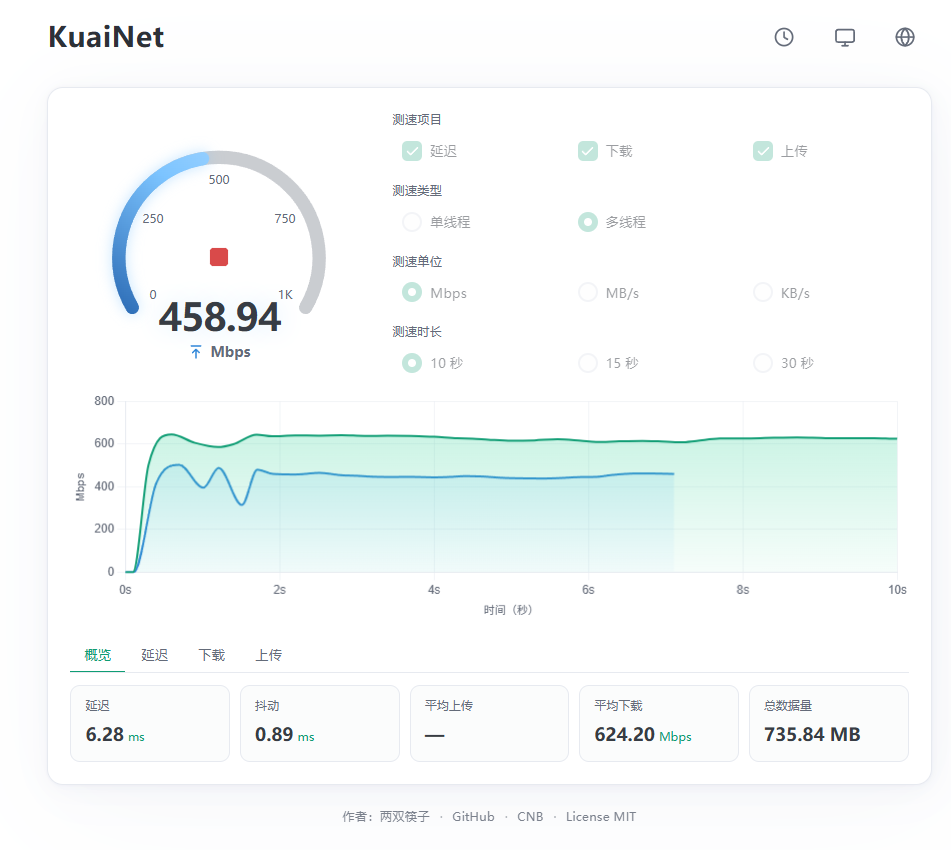
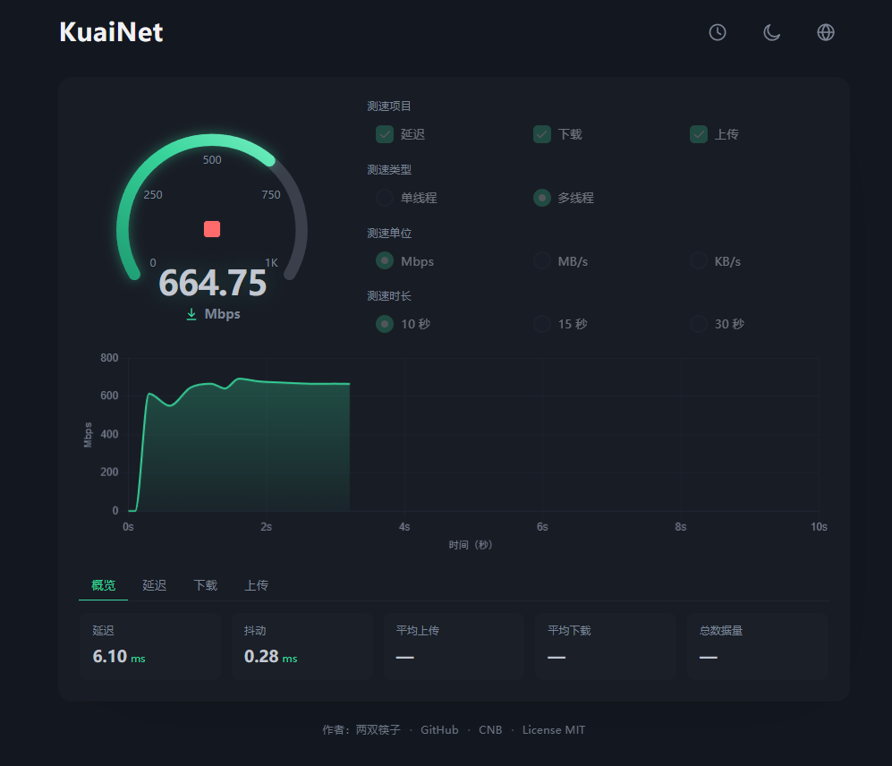
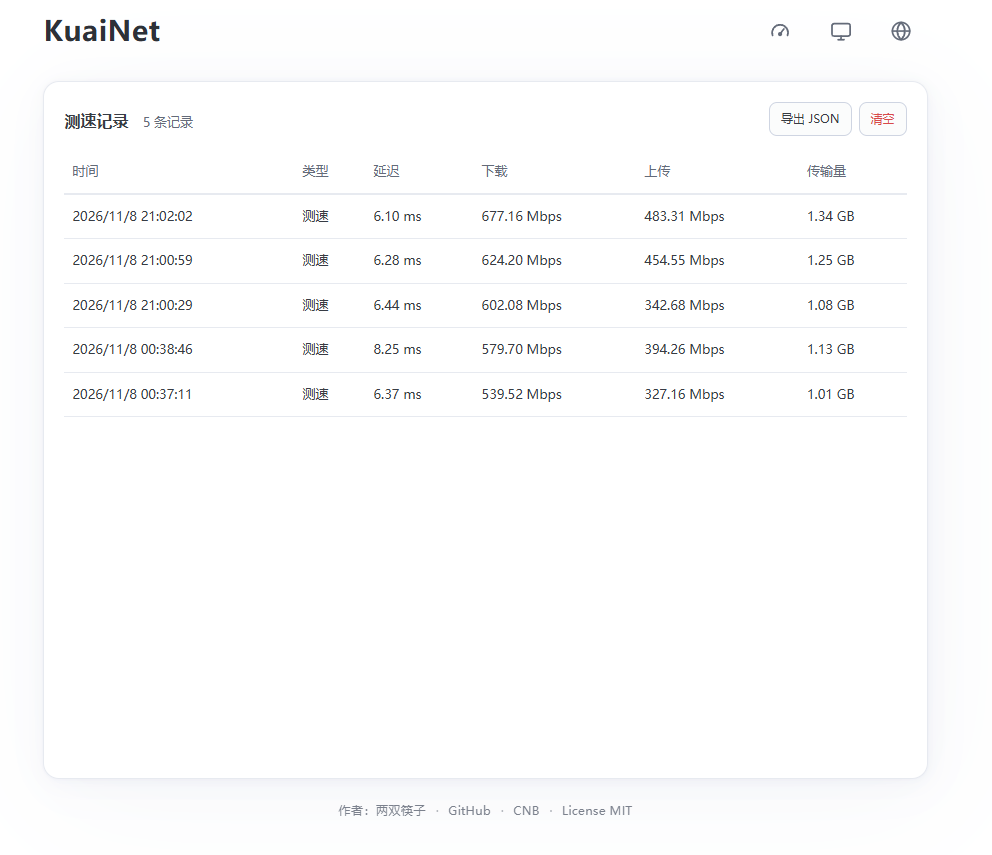
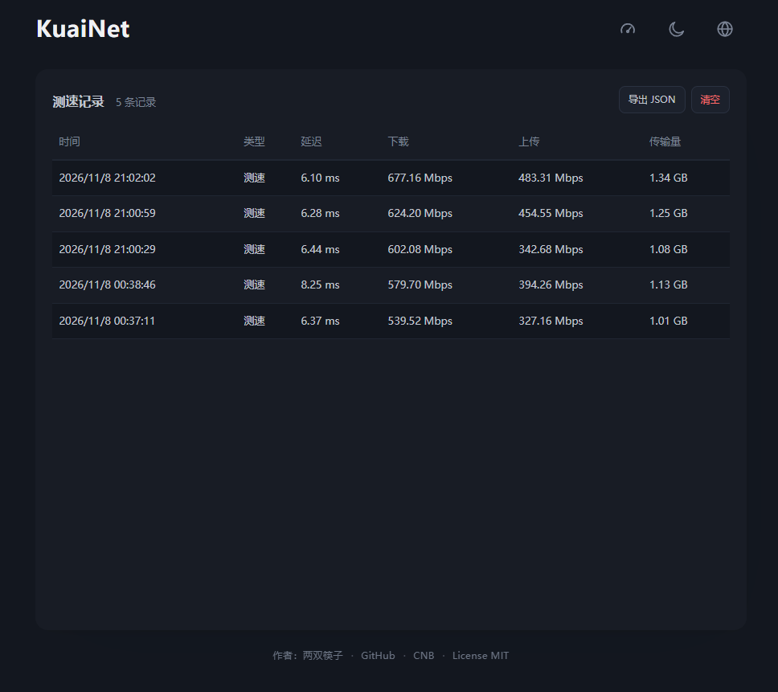
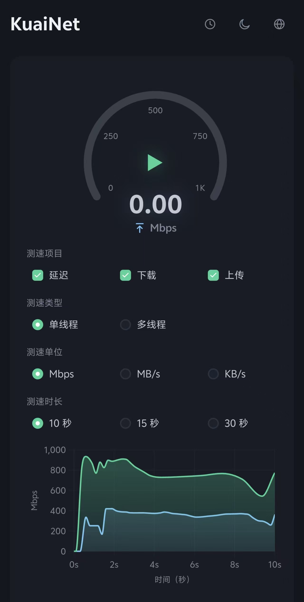
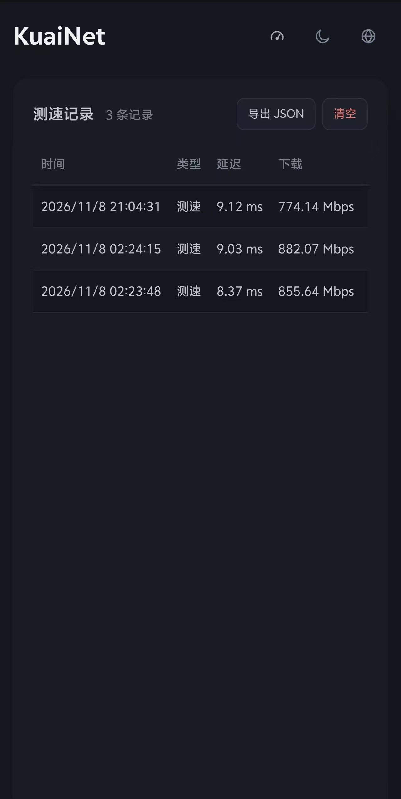

# KuaiNet

基于 Go 语言的极简内网服务器测速工具，测量「服务器 ↔ 你的浏览器」之间的下载、上传速度和延迟。

编译后是单个可执行文件，前端资源全部内嵌，**不依赖 CDN、不需要 Node.js**，内网和离线环境开箱即用。

<p align="center">
  
  
</p>

<p align="center">
  <sub>测速界面：SVG 仪表盘 + 实时曲线 + 结果概览 · 左：浅色 / 右：深色</sub>
</p>

---

## 功能

### 测速

- **延迟**：连续 10 次探测，输出最小 / 平均 / 最大延迟与抖动
- **下载**：多路并发流式下载，实时生成不可压缩数据
- **上传**：多路并发分块上传，服务端读取后直接丢弃，**不写磁盘**
- **单线程 / 多线程**：一键切换并发路数
- **时长可选**：10 秒 / 15 秒 / 30 秒，**严格跑满**，不会提前中断
- **测试项目可勾选**：只测延迟、只测下载、只测上传，或全部一起测
- 测试过程中可随时停止，已完成的部分会保留

### 精准计时（核心）

测量结果**不用「总流量 ÷ 总时间」**——那样会把 TCP 慢启动阶段一起算进去，高速网络下结果明显偏低。

实际做法是「掐头去尾」：

| 阶段 | 时间 | 是否计入结果 |
|---|---|---|
| 预热（慢启动） | 前 1.5 秒 | ❌ 流量照常计入总传输量，但不参与速度计算 |
| **稳态区间** | 1.5 秒 ~ 结束前 0.5 秒 | ✅ **只取这一段**：区间字节差 ÷ 区间时间差 |
| 收尾（断连前掉速） | 最后 0.5 秒 | ❌ 剔除 |

- 收尾窗口按时长自适应：取 `时长 × 15%` 与 `0.5 秒` 的较大值，但不超过时长的一半
- 稳态区内再剔除前后各 5% 的离群点，避免偶发卡顿影响均值
- 峰值额外做「5 点中位数滤波 + 1 秒滑窗」，防止一次补发积压数据把峰值虚高几十倍

效果（真实 1000 Mbps 链路，前 1.5 秒线性爬坡）：

| 计算方式 | 结果 |
|---|---|
| 总流量 ÷ 总时间 | 929.6 Mbps |
| **掐头去尾** | **999.3 Mbps** |

### 平滑曲线

实时曲线是两级平滑的结果，不是原始瞬时速度的硬折线：

```
原始瞬时速度 → 滑动平均（最近 1.5 秒）→ 指数移动平均（EMA, α=0.35）→ 曲线
```

- **滑动平均**：按时间戳淘汰旧点，消除单点毛刺
- **EMA**：对滑窗均值再做时间加权，抹掉「窗口滑动导致的阶梯跳变」

相邻采样点的平均跳变从 27.7 Mbps 降到 2.9 Mbps（**降低约 90%**），曲线连续过渡、不顿挫。

> 采样频率 100ms（10Hz），曲线按 200ms 打点。所有速度都按「两点字节差 ÷ 两点真实时间差」计算，不假设采样间隔恒定，因此主线程繁忙或定时器被延迟时不会算出错误的速度。

### 仪表盘与实时曲线

- SVG 仪表盘，中心为开始 / 停止按钮，读数嵌在弧内
- 量程随速度自动升档，进度弧颜色区分测试项目（延迟＝黄、下载＝绿、上传＝蓝）
- 实时曲线同时展示下载（绿）与上传（蓝），曲线本身就是进度指示
- 实时显示当前速度、平均速度、峰值、传输量、耗时

### 结果与历史

- 结果分页查看：概览 / 延迟 / 下载 / 上传
- 每次测速保存为一条历史记录，本地最多保留 60 条
- 支持导出 JSON、一键清空
- **服务端不保存任何测速记录**，数据只在你自己的浏览器里

### 界面

- **10 种语言**：简体中文、繁體中文、English、日本語、한국어、Deutsch、Français、Español、Português (Brasil)、Русский
- **单位可切换**：Mbps / MB/s / KB/s
- **三种主题**：跟随系统 / 浅色 / 深色，切换时不闪白
- **配置自动记忆**：测试项目、线程、单位、时长、当前视图都会保存在浏览器里，刷新后不会回到默认值
- **自适应布局**：手机、平板、电脑都能正常使用

---

## 使用

下载对应平台的可执行文件，运行即可：

```bash
./kuai-net
```

Windows 下双击 `kuai-net.exe` 即可。启动后终端会输出监听地址，
浏览器打开 `http://服务器IP:8080`。

### Linux

```bash
# 按架构选一个（uname -m 看：x86_64 → amd64，aarch64 → arm64）
chmod +x kuai-net-linux-amd64
./kuai-net-linux-amd64 -addr :8080
```

静态链接、无依赖，Alpine / Debian / Ubuntu / CentOS 均可直接运行。
systemd 常驻、Nginx 反代、防火墙与线上测速注意事项见 [docs/deploy-linux.md](docs/deploy-linux.md)。

可选参数：

| 参数 | 默认值 | 说明 |
|---|---|---|
| `-addr` | `:8080` | 监听地址与端口 |
| `-max-duration` | `30` | 单次测速的最长秒数（与前端时长选项一致） |

```bash
# 示例：监听 9000 端口
./kuai-net -addr :9000

# 想限制最长测试时长（例如只允许 10 秒档）
./kuai-net -addr :9000 -max-duration 10
```

### 从源码构建

需要 Go 1.22 及以上。前端资源通过 `go:embed` 嵌入，构建产物是单个可执行文件。

```bash
go build -o kuai-net .
go test ./...
```

---

## 浏览器兼容性

推荐使用 2023 年以后发布的浏览器，桌面端与移动端均可。

| 浏览器 | 最低版本 | 说明 |
|---|---|---|
| Chrome / Edge | 111+ | 推荐 |
| Firefox | 113+ | 推荐 |
| Safari（macOS / iOS） | 16.4+ | iOS 16.4 起支持所需特性 |
| Android 浏览器 / 微信内置浏览器 | Chromium 111+ | 部分旧机型可能偏低 |

测速依赖流式下载（`ReadableStream`）、`AbortController`、`color-mix()` 等现代特性，
过旧的浏览器（如 IE、旧版国产双核浏览器的兼容模式）无法运行。

若某台设备测不上速度，可先尝试更换浏览器内核（如极速模式）或升级系统。

---

## 注意事项

- **测速很费流量**：10 秒多并发在千兆内网可能产生数 GB 流量，注意服务器带宽或流量计费
- 上传测试的流量不写入磁盘，但会计入网卡流量
- 结果中的「平均速度」是稳态区间的值，可能高于「传输量 ÷ 耗时」，这是设计使然（慢启动段被剔除了）
- 建议仅在可信内网使用；如需公网暴露，请自行在反向代理层加上鉴权与限流

---

## 界面截图

> 截图放在 `docs/images/` 目录，同名覆盖即可更新。

**测速界面**

<table>
  <tr>
    <td width="50%" align="center" valign="top">
      <br>
      <sub><b>浅色主题</b></sub>
    </td>
    <td width="50%" align="center" valign="top">
      <br>
      <sub><b>深色主题</b></sub>
    </td>
  </tr>
</table>

**历史记录**

<table>
  <tr>
    <td width="50%" align="center" valign="top">
      <br>
      <sub><b>浅色主题</b>：本地保存最近 60 条，支持导出 JSON</sub>
    </td>
    <td width="50%" align="center" valign="top">
      <br>
      <sub><b>深色主题</b>：卡片高度与测速页一致，记录多时表格内部滚动</sub>
    </td>
  </tr>
</table>

**手机端**

<table>
  <tr>
    <td width="50%" align="center" valign="top">
      <br>
      <sub><b>测速界面</b>：单列布局，仪表盘与曲线纵向排列</sub>
    </td>
    <td width="50%" align="center" valign="top">
      <br>
      <sub><b>历史记录</b>：列表可横向滑动查看全部列</sub>
    </td>
  </tr>
</table>

---

## License

[MIT](https://opensource.org/license/mit) © 两双筷子

- 作者主页：<https://www.dbkuaizi.com>
- GitHub：<https://github.com/dbkuaizi/kuai-net>
- CNB：<https://cnb.cool/dbkuaizi/kuai-net>
